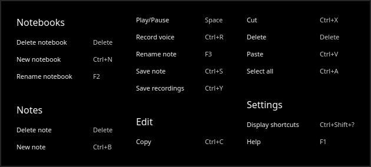
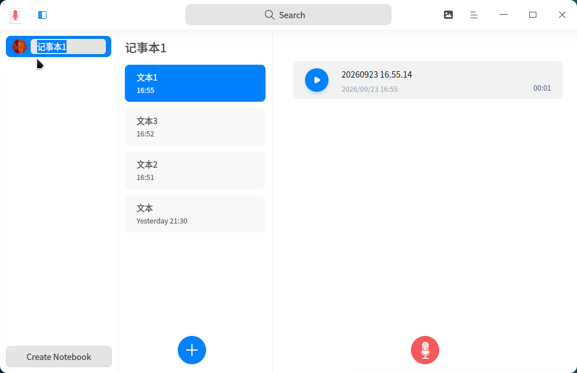
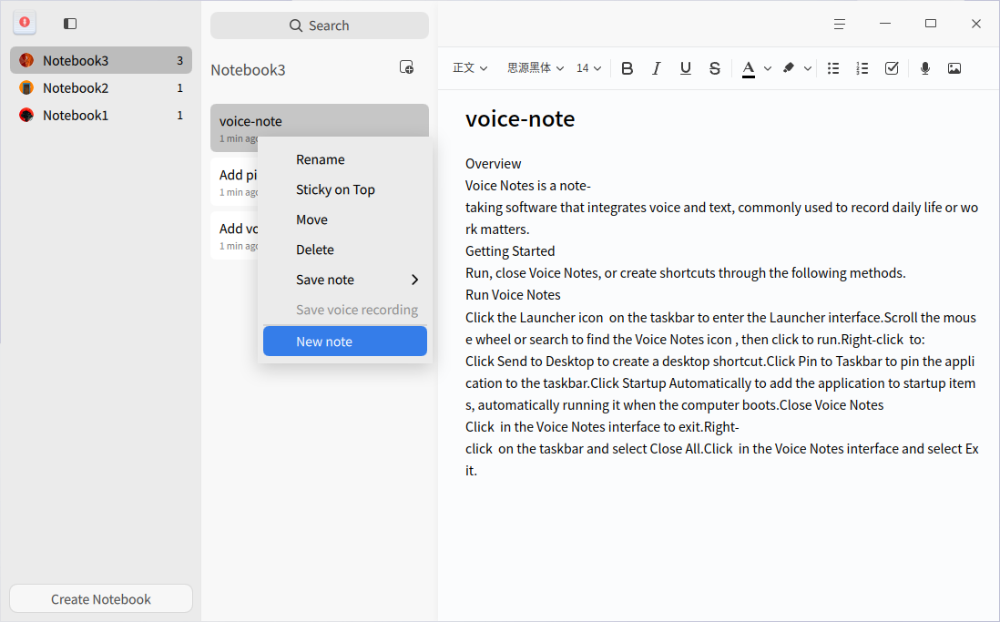
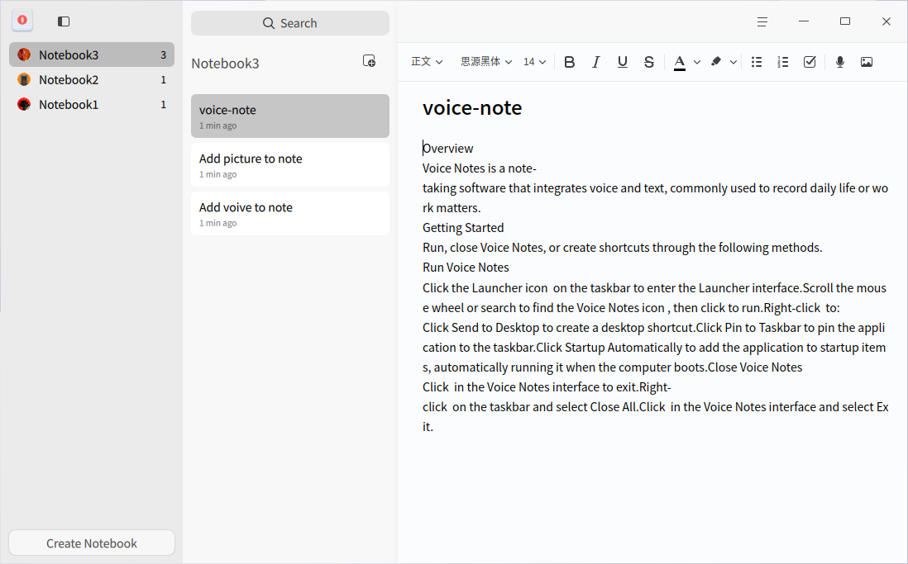
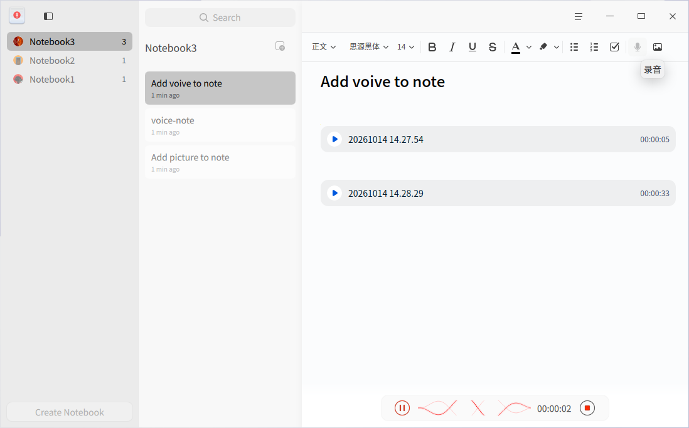
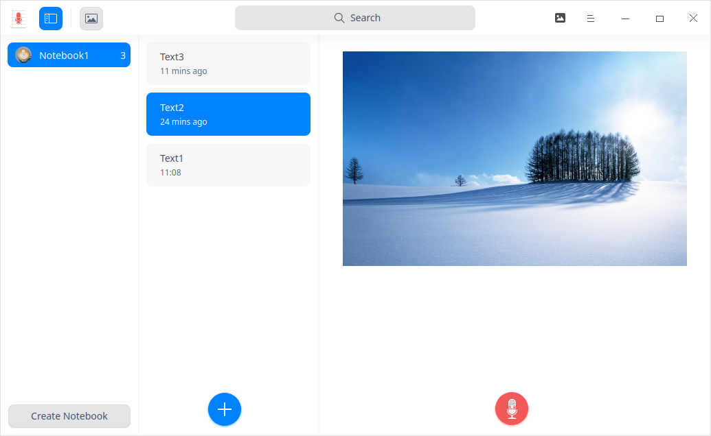
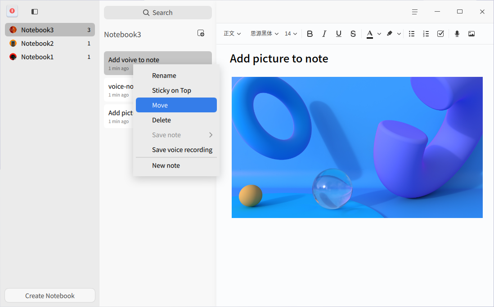
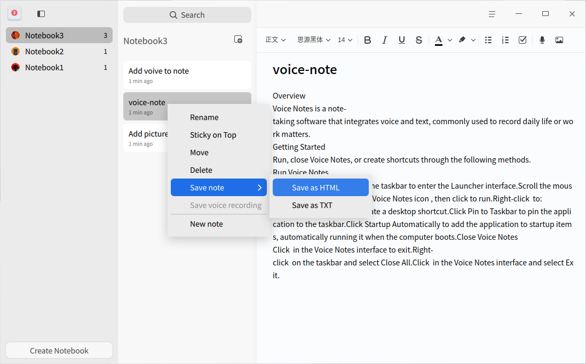
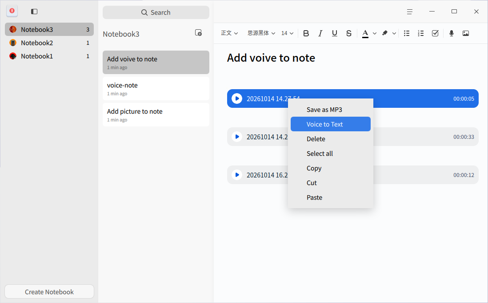
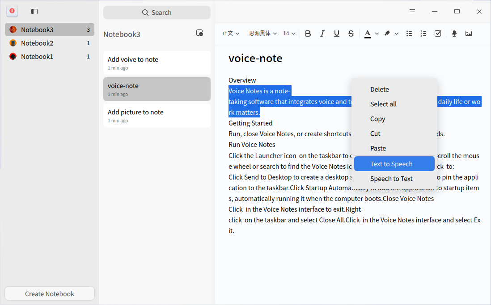

# Voice Notes|deepin-voice-note|

## Overview

Voice Notepad is a note-taking software that integrates both voice and text, commonly used for recording daily life or work tasks.

## Getting Started

You can run or close Voice Notepad using the following methods, and also create shortcuts.

### Running Voice Notepad

1. Click the Launcher icon  on the taskbar to enter the Launcher interface.
2. Scroll the mouse wheel up and down to browse or search for the Voice Notepad icon , then click to run it.
3. Right-click  to:
   - Click **Send to Desktop** to create a shortcut on the desktop.
   - Click **Send to Taskbar** to pin the application to the taskbar.
   - Click **Startup Automatically** to add the application to the startup items, so it runs automatically when the computer boots.

### Closing Voice Notepad

- Click  in the Voice Notepad interface to exit.
- Right-click  on the taskbar and select **Close All** to exit Voice Notepad.
- Click  in the Voice Notepad interface, choose **Exit** to close the application.

### Viewing Shortcuts

In the Voice Notepad interface, use the shortcut **Ctrl + Shift + ?** to open the shortcuts preview. Mastering these shortcuts will significantly improve your efficiency.

## Notepad Management

### Creating a New Notepad

- If there are no existing notepads in Voice Notepad, click **New Notepad** to create one.
- At the bottom of the notepad list, click **New Notepad** to create a new notepad.

>  Tip: You can drag and drop notepads in the list to reorder them; click the icon  in the menu bar to hide the notepad list, and click it again to show the list.

### Renaming a Notepad

1. In the notepad list, double-click the notepad or right-click and select **Rename**.
2. Enter the new name in the text box.
3. Click a blank area of the interface or press **Enter** on the keyboard to confirm the rename.

### Deleting a Notepad

1. In the notepad list, select a notepad.
2. Right-click and choose **Delete** or press the **Delete** key on the keyboard.
3. A confirmation dialog ("Confirm Delete Notepad") will appear; click **Confirm**.

## Note Management

### Creating a New Note

- When you create a new notepad for the first time, the system automatically creates a note. Click the add button  in the note list to continue creating new notes.
- Right-click a notepad or note and select **New Note** to create one.

#### Adding Text to a Note

1. In the note list, select a note.
2. Move the cursor into the details pane on the right, click the left mouse button, and start typing.
3. After selecting the text, you can set text styles (e.g., font, size, color, bold) in the top toolbar.

#### Adding Voice to a Note

1. In the note list, select a note.
2. Click the record button  in the top toolbar to start recording.
3. Click the finish button  to complete the recording.

   >  Note: During recording, you can click the pause button  to pause and the record button  to resume. The maximum recording duration is 60 minutes.
4. After recording, click the play button  to replay the recording.

#### Adding Images to a Note

You can add images to a note in the following ways:
- Click the picture icon  in the top toolbar, select an image file from the pop-up window, and import it.
- Drag and drop an image into the details pane.
- Copy and paste an image.

### Renaming a Note

1. In the note list, double-click the note or right-click and select **Rename**.
2. Enter the new name in the text box.
3. Click a blank area or press **Enter** to confirm the rename.

### Searching Notes

1. In the search box at the top of Voice Notepad, click  and enter a keyword.
2. Press **Enter** to view the search results.
3. Click  in the search box to clear the keyword or cancel the search.

### Moving Notes

In the note list, select one or multiple notes (using **Ctrl/Shift**), then:
- Drag and drop the note(s) to another notepad.
- Right-click and choose **Move**, then select the target notepad.

### Pinning Notes

1. In the note list, right-click a note.
2. Select **Pin** to move it to the top of the list. For pinned notes, right-click and choose **Unpin**.

### Saving Notes

1. In the note list, select one or multiple notes (using **Ctrl/Shift**).
2. Right-click, and under **Save Note**, choose **Save as HTML** or **Save as TXT** to save the note in the respective format.

   > Note:
   >- TXT format saves only text notes and metadata for voice notes (e.g., recording time, duration), excluding audio and images.
   >- HTML format saves text and images but excludes audio.

### Saving Voice

1. In the note list, select one or multiple voice notes (using **Ctrl/Shift**).
2. Right-click and choose **Save Voice** to save the selected voice notes as MP3 files.

>  Tip: You can also right-click a specific audio file and select **Save as MP3** to save it to your local storage.

### Voice-to-Text

1. In the Voice Notepad interface, select a voice file.
2. Right-click and choose **Voice-to-Text**; the voice content will be transcribed into text in the details pane.

### Text-to-Speech

1. Select a piece of text, right-click, and choose **Text-to-Speech** to hear the selected text spoken aloud.
2. Click the close button on the speech control to stop playback.

> Note:
>- The **Text-to-Speech** option is grayed out if no text is selected.
>- For voice notes, **Text-to-Speech** is only available if the audio has been transcribed into text.

### Voice Dictation

1. In the text editing area, right-click and select **Voice Dictation** to input speech via the microphone; the transcribed text will appear at the cursor position.
2. Click the close button on the dictation control to stop.

> Tip: You can enable voice dictation while recording audio.

### Deleting Notes

1. In the note list, select one or multiple notes (using **Ctrl/Shift**).
2. Right-click and choose **Delete** or press the **Delete** key.
3. A confirmation dialog ("Confirm Delete Note") will appear; click **Confirm**.

### Deleting Voice

1. In the Voice Notepad interface, select a voice file.
2. Right-click and choose **Delete** or press the **Delete** key.

## Main Menu

In the main menu, you can configure audio sources, view the privacy policy, switch window themes, access the help manual, and learn more about Voice Notepad.

### Settings

You can set the audio source, including system audio and microphone audio.
1. In the Voice Notepad interface, click .
2. Configure the audio source:
   - Select **System Audio** to record only built-in system sounds.
   - Select **Microphone Audio** to record only microphone input.

### Privacy Policy

1. In the Voice Notepad interface, click .
2. Select **Privacy Policy** to open and review the policy.

### Theme

Window themes include Light, Dark, and System themes.
1. In the Voice Notepad interface, click .
2. Select **Theme** and choose a theme color.

### Help

Access the help manual for further guidance on using Voice Notepad.
1. In the Voice Notepad interface, click .
2. Select **Help**.
3. Review the Voice Notepad manual.

### About

1. In the Voice Notepad interface, click .
2. Select **About**.
3. View the Voice Notepad version and description.

### Exit

1. In the Voice Notepad interface, click .
2. Select **Exit** to close the application.