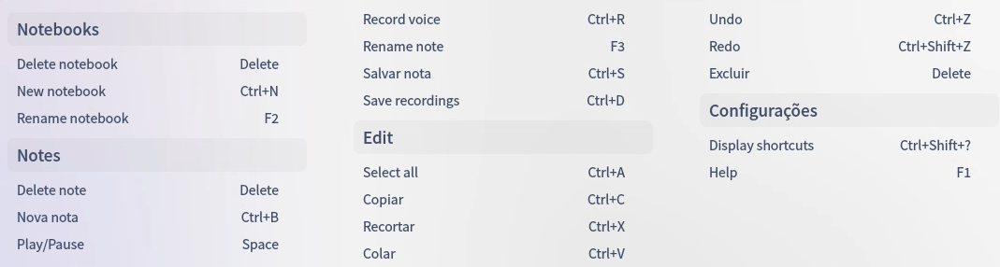
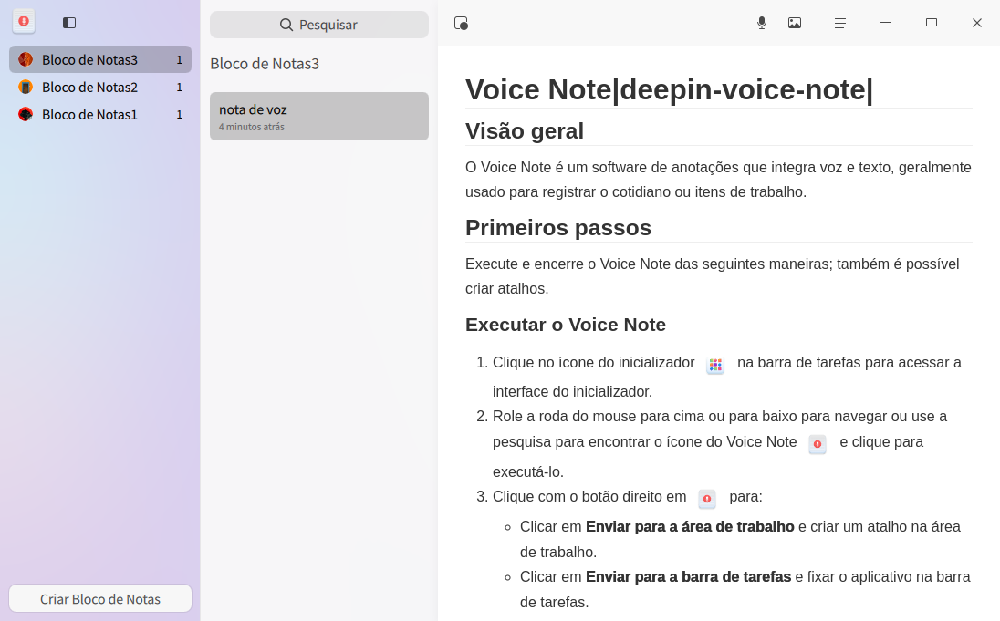
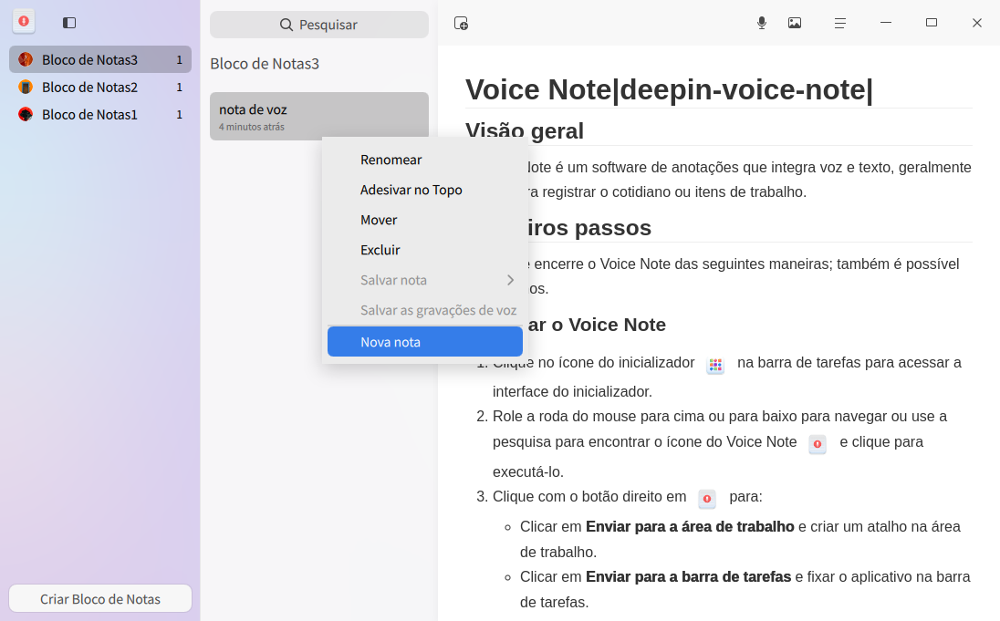
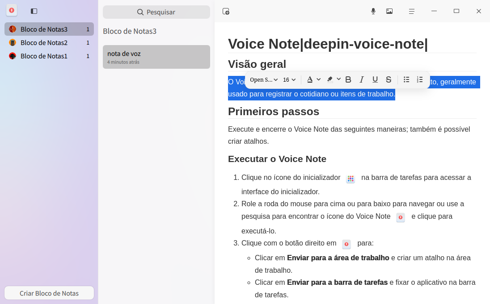
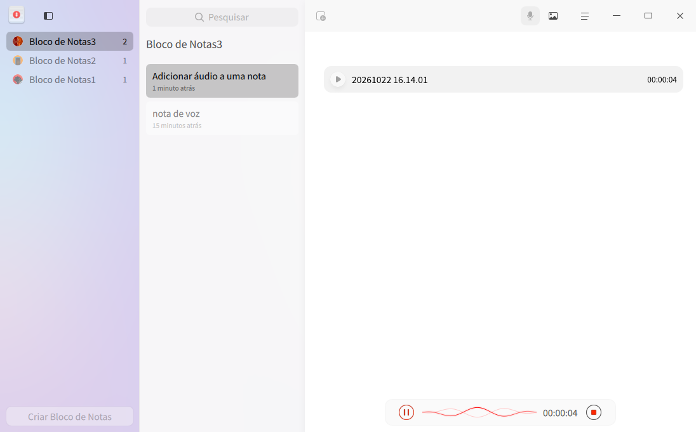
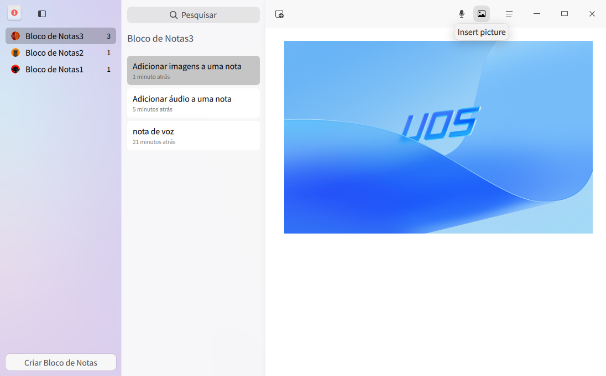
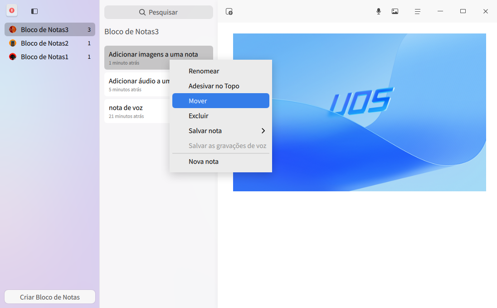
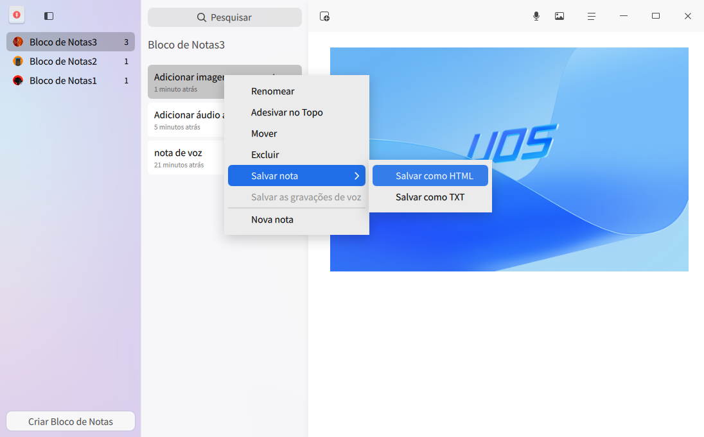
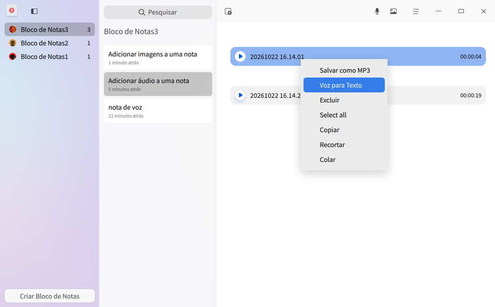
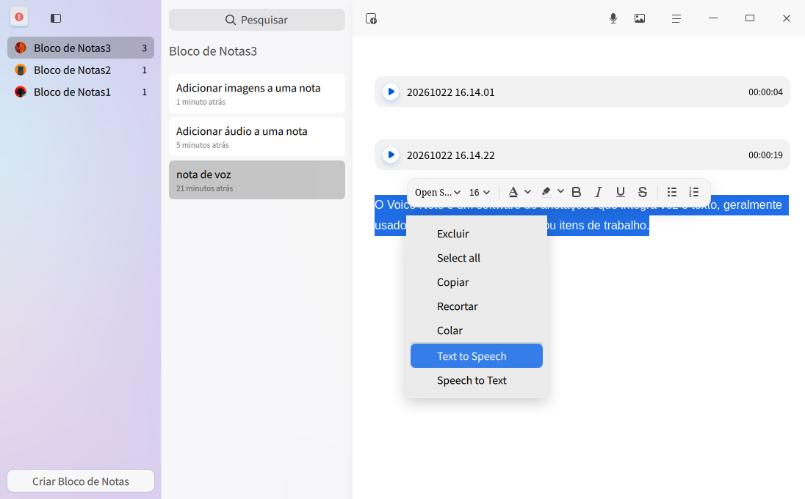

# Voice Note|deepin-voice-note|

## Visão geral

O Voice Note é um software de anotações que integra voz e texto, geralmente usado para registrar o cotidiano ou itens de trabalho.

## Primeiros passos

Execute e encerre o Voice Note das seguintes maneiras; também é possível criar atalhos.

### Executar o Voice Note

1. Clique no ícone do inicializador  na barra de tarefas para acessar a interface do inicializador.
2. Role a roda do mouse para cima ou para baixo para navegar ou use a pesquisa para encontrar o ícone do Voice Note  e clique para executá-lo.
3. Clique com o botão direito em  para:

   - Clicar em **Enviar para a área de trabalho** e criar um atalho na área de trabalho.
   - Clicar em **Enviar para a barra de tarefas** e fixar o aplicativo na barra de tarefas.
   - Clicar em **Iniciar automaticamente na inicialização** e adicionar o aplicativo aos itens de inicialização, fazendo com que ele seja executado automaticamente quando o computador for iniciado.

### Encerrar o Voice Note

- Na interface do Voice Note, clique em  para sair do Voice Note.
- Na barra de tarefas, clique com o botão direito em  e selecione **Fechar todas** para sair do Voice Note.
- Na interface do Voice Note, clique em  e selecione **Sair** para sair do Voice Note.

### Exibir atalhos de teclado

Na interface do Voice Note, use o atalho de teclado **Ctrl + Shift + ?** para abrir a interface de visualização de atalhos. O uso habilidoso dos atalhos de teclado aumentará muito a sua eficiência operacional.

## Gerenciamento de cadernos de notas

### Criar um caderno de notas

- Quando ainda não houver cadernos de notas no Voice Note, clique em **Novo caderno de notas** para criar um novo caderno de notas.
- Na parte inferior da lista de cadernos de notas, clique em **Novo caderno de notas** para criar um novo caderno de notas.

>  Dica: você pode arrastar os cadernos de notas na lista para ajustar a ordem; clique no ícone  na barra de menus para ocultar a lista de cadernos de notas e clique novamente para exibi-la.

### Renomear um caderno de notas

1. Na lista de cadernos de notas, clique duas vezes no caderno de notas ou selecione **Renomear** no menu de contexto.
2. Digite o novo nome no campo de texto.
3. Clique em uma área vazia da interface ou pressione a tecla **Enter** no teclado para concluir a renomeação.

### Excluir um caderno de notas

1. Na lista de cadernos de notas, selecione um caderno de notas.
2. Clique com o botão direito e selecione **Excluir** ou pressione a tecla **Delete** no teclado.
3. Na caixa de diálogo "Confirmar exclusão do caderno de notas", clique em **OK**.

## Gerenciamento de notas

### Criar uma nota

- Após criar um caderno de notas pela primeira vez, o sistema já cria uma nota por padrão; na lista de notas, clique no botão de adicionar  para continuar criando novas notas.
- Clique com o botão direito em um caderno de notas ou em uma nota e selecione **Nova nota** para criar uma nova nota.

#### Adicionar texto a uma nota

1. Na lista de notas, selecione uma nota.
2. Mova o cursor para a página de detalhes à direita, clique com o botão esquerdo do mouse e digite o texto.
3. Selecione o conteúdo do texto para abrir a barra de ferramentas de texto, na qual você pode definir o estilo do texto, por exemplo: fonte, tamanho da fonte, cor da fonte, negrito etc.

#### Adicionar áudio a uma nota

1. Na lista de notas, selecione uma nota.
2. Na parte superior, clique no botão de gravação  para adicionar áudio.
3. Clique no botão de concluir  para concluir a gravação de áudio.

   >  Observação: durante a adição de áudio, você pode clicar no botão de pausa  para pausar a gravação e clicar novamente no botão de gravação  para continuar a gravação. A duração máxima da gravação é de 60 minutos.

4. Após a gravação, clique no botão de reprodução  para reproduzir o áudio gravado.

#### Adicionar imagens a uma nota

Você pode adicionar imagens a uma nota usando um dos seguintes métodos.

- Clique no ícone  na barra de menus, selecione o arquivo de imagem na janela exibida e importe-o.
- Arraste a imagem para a página de detalhes à direita.
- Adicione imagens por meio de copiar e colar.

### Renomear uma nota

1. Na lista de notas, clique duas vezes na nota ou selecione **Renomear** no menu de contexto.
2. Digite o novo nome no campo de texto.
3. Clique em uma área vazia da interface ou pressione a tecla **Enter** no teclado para concluir a renomeação.

### Pesquisar notas

1. No campo de pesquisa na parte superior do Voice Note, clique em  e digite a palavra-chave.
2. Pressione a tecla **Enter** no teclado para exibir os resultados da pesquisa.
3. No campo de pesquisa, clique em  para limpar a palavra-chave digitada ou cancelar a pesquisa.

### Mover notas

Na lista de notas, selecione uma nota ou pressione as teclas **Ctrl/Shift** para selecionar várias notas; use um dos seguintes métodos para mover as notas.

- Segure o botão esquerdo do mouse e arraste a nota para outro caderno de notas.
- Clique com o botão direito e selecione **Mover**; a nota será movida para o caderno de notas selecionado.

### Fixar notas no topo

1. Na lista de notas, clique com o botão direito na nota.
2. Selecione **Fixar no topo**; a nota será exibida no início da lista de notas.

   Clique com o botão direito em uma nota já fixada no topo e selecione **Desafixar**.

### Salvar notas

1. Na lista de notas, selecione uma nota ou pressione as teclas **Ctrl/Shift** para selecionar várias notas.
2. Clique com o botão direito e, no submenu de **Salvar nota**, selecione **Salvar como HTML** ou **Salvar como TXT** para salvar a nota nos formatos HTML ou TXT.

   > Observação:
   >
   >- O formato TXT salva apenas notas de texto, o horário de gravação e a duração das notas de áudio etc.; não salva arquivos de áudio nem imagens.
   >- O formato HTML salva apenas imagens e notas de texto; não salva arquivos de áudio.

### Salvar áudio

1. Na lista de notas, selecione uma nota de áudio ou pressione as teclas **Ctrl/Shift** para selecionar várias notas de áudio.
2. Clique com o botão direito e selecione **Salvar áudio** para salvar as notas de áudio selecionadas no formato MP3.

>  Dica: você também pode selecionar um arquivo de áudio específico de uma nota de áudio, clicar com o botão direito e selecionar **Salvar como MP3** para salvar esse arquivo de áudio no dispositivo de armazenamento local.

### Converter áudio em texto

1. Na interface do Voice Note, selecione um arquivo de áudio.
2. Clique com o botão direito e selecione **Converter áudio em texto**; o conteúdo do áudio será exibido em forma de texto na página de detalhes.

### Leitura em voz alta

1. Após selecionar um trecho de texto, clique com o botão direito e selecione **Leitura em voz alta**; o texto selecionado será lido em voz alta.
2. Durante a leitura, clique no botão de fechar do controle de leitura para encerrar a leitura em voz alta.

> Observação:
>
>- Quando nenhum texto estiver selecionado, a opção Leitura em voz alta ficará esmaecida e indisponível.
>- Quando apenas um arquivo de áudio estiver selecionado, a Leitura em voz alta não estará disponível; se o arquivo de áudio já tiver sido convertido em texto, você poderá selecionar o conteúdo de texto para realizar a leitura em voz alta.

### Ditado por voz

1. Na área de edição de texto, clique com o botão direito e selecione **Ditado por voz**; o áudio será captado pelo microfone e o texto transcrito será inserido na posição do cursor.
2. No modo de ditado, clique no botão de fechar do controle de ditado para interromper o ditado por voz.

>  Dica: durante a gravação de áudio, você pode ativar simultaneamente o ditado por voz.

### Excluir notas

1. Na lista de notas, selecione uma nota ou pressione as teclas **Ctrl/Shift** para selecionar várias notas.
2. Clique com o botão direito e selecione **Excluir** ou pressione a tecla **Delete** no teclado.
3. Na caixa de diálogo "Confirmar exclusão da nota", clique em **OK**.

### Excluir áudio

1. Na interface do Voice Note, selecione um arquivo de áudio.
2. Clique com o botão direito e selecione **Excluir** ou pressione a tecla **Delete** no teclado.

## Menu principal

No menu principal, você pode definir a fonte de áudio, consultar a política de privacidade, alternar o tema da janela, consultar o manual de ajuda e obter mais informações sobre o Voice Note.

### Configurações

Você pode definir a fonte de áudio, incluindo som do sistema e som do microfone.

1. Na interface do Voice Note, clique em .
2. Defina a fonte de áudio:
   - Selecione **Som do sistema** para gravar apenas o som interno do sistema durante a gravação.
   - Selecione **Som do microfone** para gravar apenas o som do microfone durante a gravação.

### Política de privacidade

1. Na interface do Voice Note, clique em .
2. Selecione **Política de privacidade** para abrir o link da política de privacidade e consultar o conteúdo relacionado.

### Tema

O tema da janela inclui tema claro, tema escuro e tema do sistema.

1. Na interface do Voice Note, clique em .
2. Selecione **Tema** e escolha uma cor de tema.

### Ajuda

Consulte o manual de ajuda para conhecer e usar melhor o Voice Note.

1. Na interface do Voice Note, clique em .
2. Selecione **Ajuda**.
3. Consulte o manual de ajuda do Voice Note.

### Sobre

1. Na interface do Voice Note, clique em .
2. Selecione **Sobre**.
3. Consulte a versão e a apresentação do Voice Note.

### Sair

1. Na interface do Voice Note, clique em .
2. Selecione **Sair**.
